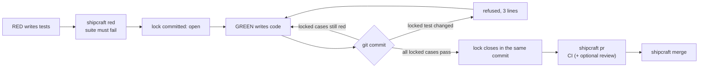

# Shipcraft

**A seatbelt for test-driven development with coding agents.**

Code is cheap now. Judgment isn't. Shipcraft makes sure the judgment you put into a test can't be quietly undone by the code that is supposed to satisfy it, and it stays out of the way the rest of the time.

```text
$ git commit -m "fix rounding"
shipcraft refused: locked test tests/test_invoice.py changed after RED (index)
Why: RED is the contract: GREEN changes the code, not the test that judges it
Next: undo the change in tests/test_invoice.py; if the test looks wrong, stop and tell the RED author
```

---

## Why

A coding agent asked to make a failing test pass has two ways to do it: fix the code, or "fix" the test. Most of the time it fixes the code. Sometimes, under pressure from a hard bug, a confusing assertion or a long session, it edits the assertion, skips the case, deletes the file, or changes the runner config so the suite goes green. Every one of those looks like progress in the diff summary.

Prose rules in `AGENTS.md` ("never edit the tests") help, but nothing enforces them. Shipcraft turns that rule into a mechanical check that runs where agents can't argue with it: in the git hook and again in CI.

## How it works

Work is split into two roles, and they should be different agents (or an agent and you):

- **RED** writes the tests that describe the change and runs `shipcraft red`. Shipcraft runs the suite, requires it to **fail on assertions**, and writes a **lock** with a hash of every test file, the config and the failing cases. The lock is committed with the tests.
- **GREEN** writes the code. While the lock is open, any commit that changes, deletes or skips a locked test, or touches the config, is refused. The first commit where every locked case passes **closes the lock by itself**.



The hook only runs the locked cases, so commits stay fast. `shipcraft ci` then repeats every check on every commit of the branch, from a clean checkout, and runs the full suite. A commit made with `--no-verify` or with an edited hook is caught there.

Every refusal is three lines: **what happened, why it matters, and the next step**. Most "Next" lines contain the exact command to run, so an agent that has never heard of Shipcraft can recover on its own.

## What it guarantees, and what it doesn't

**It guarantees** that a branch cannot reach your main through `shipcraft merge` (or through required status checks on GitHub) if any commit changed, removed or skipped a test that was locked at RED, or changed the config that decides how tests run, while the lock was open.

**The threat model is the honest agent that makes mistakes or takes shortcuts.** It is not an adversary rewriting Shipcraft itself. Shipcraft does not sandbox anything, and a determined human with admin rights can always merge around it. When that happens, `shipcraft ci` on main reports the merges that skipped the gate.

**It does not judge whether your tests are good.** That's the RED's job, and the review layer's. Shipcraft protects the judgment once it has been made.

## Quick start

```bash
# build from source (macOS or Linux, Rust toolchain)
git clone https://github.com/victorassisalves/shipcraft && cd shipcraft
cargo install --path nucleo
```

Prebuilt macOS binaries (Apple silicon and Intel, checksum-verified) come with the first tagged release.

Then, in your project:

```bash
shipcraft init          # detects the language, writes .shipcraft.toml, wires the hook
git add .shipcraft.toml && git commit -m "add shipcraft"
```

A cycle:

```bash
# RED: write the failing tests, then lock them
shipcraft red
git add -A && git commit -m "red: invoice rounding"

# GREEN: write the code; commit as often as you like
git commit -am "fix rounding"      # the lock closes on the first fully green commit

# open the PR: CI runs (and review, if on) and the statuses are published
shipcraft pr --title "Invoice rounding"

# merge only when both are green
shipcraft merge 42
```

`shipcraft status` shows the open locks and how protected the repository really is.

## Commands

| Command | What it does |
|---|---|
| `shipcraft init [--lang python\|node\|go] [--github]` | Detects the language and test runner, writes `.shipcraft.toml`, and wires the hook into your hook manager. |
| `shipcraft --version` | Prints the version and build commit. |
| `shipcraft red` | Runs the suite, requires assertion failures, and writes the lock in `.shipcraft/locks/<id>.json`. |
| `shipcraft check [--commit-msg <file>]` | Called by the hook. Judges the commit being made against open locks and closes a lock when its cases pass. |
| `shipcraft close` | Closes a lock by hand when your hook setup can't do it in the same commit. |
| `shipcraft ci --base <ref> [--pr]` | Re-checks every commit in `<ref>..HEAD` and runs the full suite on HEAD. Runs locally or in GitHub Actions. |
| `shipcraft pr [--title <t>] [--body <file>]` | Pushes the branch, opens or updates the PR, runs CI and the review when it is on, and publishes the `shipcraft/ci` and `shipcraft/review` statuses. |
| `shipcraft review [--pr <n>]` | Runs the review on the local HEAD (to catch blockers before opening the PR) or on any PR. |
| `shipcraft merge <pr> [--no-review "<reason>"]` | Merges only when CI and review are green on the PR's head. `--no-review "<reason>"` is the recorded way out, and the reason shows up in the PR and in the numbers. |
| `shipcraft status` | The open locks, and how protected the repository really is (branch protection or only `shipcraft merge`). |

## Languages, runners and hook managers

| | Supported |
|---|---|
| Languages | Python, TypeScript/JavaScript, Go, and any runner that writes JUnit XML through a generic suite |
| Runners | pytest, vitest, jest, `go test` / gotestsum, anything else via `[[suite]]` |
| Hook managers | plain git hooks, lefthook, husky, pre-commit |
| Repositories | single package or monorepo (several `[[suite]]` entries), TypeScript project references (`[build]`) |
| CI | local (on your machine, no runner needed) or GitHub Actions |
| Review | a separate agent session: Codex, Claude or Gemini CLI |

When `init` finds a hook manager, it integrates with it instead of overwriting it. Shipcraft never edits your test files, your runner config or your existing hooks.

## Configuration

`shipcraft init` writes `.shipcraft.toml`. In `command`, `{junit}` is replaced by the path where the runner writes its JUnit report. A typical file:

```toml
shipcraft_min = "2.0"

[[suite]]
name = "api"
root = "packages/api"
command = "npx --no -- vitest run --reporter=junit --outputFile={junit}"
globs = ["**/*.test.ts", "vitest.config.*"]

[execution]
ci = "local"        # local | github | off
review = "off"      # off | local (optional)

[roles]
review = "codex"    # codex | claude | gemini
```

Two rules keep the config honest:

- **The config is part of the lock.** It can't change while a lock is open.
- **A PR is judged by the config on the base branch,** not by its own. A PR can't switch off its own review.

A layer that is switched off is labeled "off in .shipcraft.toml" on every PR, so nobody mistakes it for a check that ran.

## The layers

| Layer | When it runs | What it catches |
|---|---|---|
| Hook | every commit | edits to locked tests or config, skipped or missing cases; closes the lock when green |
| CI | every PR | everything the hook checks, on every commit, from a clean checkout, plus the full suite |
| Review (optional, off by default) | every PR, after CI is green | a different agent reads the diff against the spec and the PR body, and runs its own checks. A blocker counts only if the reviewer reproduced it and it breaks a quoted spec rule or crashes. Errors, timeouts and quota failures are never an approval. |
| Merge gate | `shipcraft merge` | refuses unless CI (and review, when on) are green on the PR head |

On a public repository (or a paid GitHub plan), `shipcraft init --github` also marks `shipcraft/ci` as required, so the platform enforces the gate too.

## Measured, not asserted

Shipcraft records every hook, CI and review run in `.git/shipcraft/runs.jsonl`: layer, result, refusal code and time. Nothing is sent anywhere. `shipcraft pr` puts the branch's numbers in the PR summary. A `shipcraft report` command that gives time-to-main per item is next on the roadmap.

Every rule in Shipcraft has to pay for itself. It ships with the metric that justifies it and the condition that removes it. Rules that don't catch anything in practice get deleted.

## Working with coding agents

Agents don't need a plugin, an MCP server or a skill. They find Shipcraft the same way they find every other project constraint:

- `git commit` runs the hook, and refusals say exactly what to do next;
- a short block in `AGENTS.md` tells agents to run `shipcraft red` after writing tests. In our trials this took agents from 0/4 to 4/4 locking their tests before the first commit.

Give the RED and the GREEN to different sessions. They can be the same model; separate context is what matters.

## Status and limits

Shipcraft 2 is a rewrite of an earlier internal version, built and measured in public from here on.

- **Binaries:** build from source with `cargo install --path nucleo` (macOS, Linux). Prebuilt macOS archives come with the first tagged release.
- **Windows:** not supported.
- **Fork PRs** are refused by the local review. The good-faith model doesn't hold for code from outside.
- **Not yet:** a hosted review layer (`review = "github"`), and other CI providers.

## Development

```bash
cargo build --release --manifest-path nucleo/Cargo.toml -j 4
bash acceptance/run.sh nucleo/target/release/shipcraft all   # the full acceptance battery
```

Shipcraft is developed with Shipcraft: specs in `docs/`, RED and GREEN by separate agents, and every change gated by the battery and a review.

## License

[Apache License 2.0](LICENSE)
